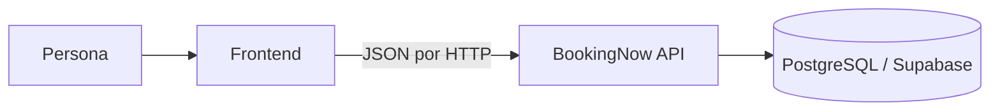
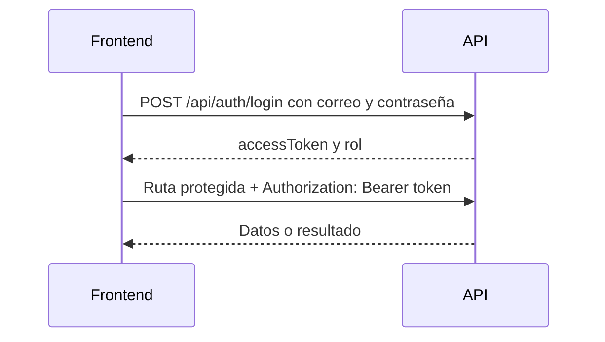

# BookingNow API

Esta API es la parte que guarda los datos y aplica las reglas del proyecto.
El frontend es lo que la persona ve; la API recibe las solicitudes del frontend.



No necesitas saber Java para usarla. Solo debes conocer la ruta, los datos que
envías y cómo usar el token recibido en el login.

## 1. Empieza por Swagger

Con la API local encendida, abre `http://localhost:8080/swagger-ui.html`.

Con la API publicada en AWS, abre `http://3.136.161.165:8080/swagger-ui.html`.

Swagger sirve para probar la API sin construir todavía el frontend: eliges una
ruta, escribes datos de ejemplo y pulsas **Execute**.

Estas son las dos direcciones base que usa el frontend React:

| Ambiente | Dirección base de la API |
|---|---|
| Local, para desarrollar | `http://localhost:8080` |
| Publicada en AWS (EC2) | `http://3.136.161.165:8080` |

Las rutas son iguales en ambos ambientes. Por ejemplo, el login siempre es
`/api/auth/login`. El frontend publicado está en
`https://booking-now-theta.vercel.app/` y la API permite su origen mediante CORS.

> La URL pública actual de EC2 usa HTTP. Un frontend servido por Vercel con HTTPS
> necesita exponer la API también por HTTPS mediante un dominio o proxy antes de
> consumirla directamente desde el navegador.
## 2. Cuentas de desarrollo

Después de ejecutar [initial-admin.sql](docs/db/initial-admin.sql) en Supabase,
estas cuentas permiten probar las pantallas. Son datos ficticios de desarrollo.

| Tipo | Correo | Contraseña | Uso |
|---|---|---|---|
| Administrador | `admin@bookingnow.local` | `AdminDemo123!` | Consultar cuentas, negocios y servicios |
| Cliente | `cliente.demo@bookingnow.local` | `ClienteDemo123!` | Probar cuenta de cliente |
| Proveedor | `proveedor.demo@bookingnow.local` | `ProveedorDemo123!` | Probar negocio y servicios |

El proveedor demo ya tiene un negocio, dos elementos multimedia y un servicio.
Estas contraseñas no son secretas y no deben usarse en producción.

## 3. Registro, login y token

Una persona se registra una vez. Luego inicia sesión con correo y contraseña.
La API devuelve un **token**, una cadena larga que prueba quién inició sesión.
Guárdalo durante la sesión y envíalo en las rutas protegidas.



El token dura 30 minutos. Si la API devuelve `401`, elimina el token y pide
iniciar sesión otra vez.

## 4. Qué puede hacer cada rol

| Rol del login | Pantallas o acciones permitidas |
|---|---|
| `CLIENTE` | Ver su cuenta, consultar servicios y disponibilidad, y registrar reservas. |
| `PROVEEDOR` | Ver su cuenta, crear sus negocios y gestionar sus servicios. |
| `ADMINISTRADOR` | Consultar clientes, proveedores, negocios y los servicios de cada negocio. |

Usa `cuenta.rol` para mostrar las opciones correctas. La API también revisa los
permisos: ocultar un botón no es una medida de seguridad por sí sola.

## 5. Todas las rutas

Para una ruta protegida agrega este encabezado:

```text
Authorization: Bearer EL_TOKEN_DEL_LOGIN
```

| Método | Ruta | Token | Uso |
|---|---|---:|---|
| GET | `/health` | No | Revisar si la API está viva |
| POST | `/api/clientes` | No | Registrar cliente |
| POST | `/api/proveedores` | No | Registrar proveedor |
| POST | `/api/auth/login` | No | Iniciar sesión de cualquier cuenta |
| GET | `/api/clientes/{id}` | Cliente dueño | Ver su cuenta |
| GET | `/api/proveedores/{id}` | Proveedor dueño | Ver su cuenta |
| DELETE | `/api/clientes/{id}` | Cliente dueño | Eliminar su cuenta |
| DELETE | `/api/proveedores/{id}` | Proveedor dueño | Eliminar su cuenta |
| GET | `/api/clientes` | Administrador | Listar clientes |
| GET | `/api/proveedores` | Administrador | Listar proveedores |
| GET | `/api/negocios` | Administrador | Listar todos los negocios |
| GET | `/api/negocios/mio` | Proveedor | Listar los negocios propios |
| POST | `/api/negocios` | Proveedor | Crear negocio |
| GET | `/api/negocios/{idNegocio}/servicios` | Proveedor dueño o administrador | Listar servicios del negocio |
| POST | `/api/negocios/{idNegocio}/servicios` | Proveedor dueño | Crear servicio |
| GET | `/api/servicios?nombre=&tipo=&pagina=0&tamano=20` | No | Buscar servicios con filtros y paginación; sin coincidencias, `contenido` llega vacío. Devuelve resumen sin imágenes. |
| GET | `/api/servicios/{idServicio}` | No | Consultar detalle de servicio y negocio |
| GET | `/api/servicios/{idServicio}/disponibilidad?fecha=AAAA-MM-DD` | No | Consultar horas y personal/recursos disponibles |
| POST | `/api/negocios/{idNegocio}/recursos` | Proveedor dueño | Registrar recurso |
| GET | `/api/negocios/{idNegocio}/recursos` | Proveedor dueño | Listar recursos |
| POST | `/api/negocios/{idNegocio}/empleados` | Proveedor dueño | Registrar empleado |
| GET | `/api/negocios/{idNegocio}/empleados` | Proveedor dueño | Listar empleados |
| PUT | `/api/negocios/{idNegocio}/horarios` | Proveedor dueño | Configurar o reemplazar el horario semanal |
| GET | `/api/negocios/{idNegocio}/horarios` | Proveedor dueño | Consultar horario semanal |
| PUT | `/api/negocios/{idNegocio}/servicios/{idServicio}/asignaciones` | Proveedor dueño | Reemplazar asignación de empleados y recursos |
| POST | `/api/reservas` | Cliente | Registrar reserva (el correo de confirmación aún no está conectado) |

El contrato para las nuevas tablas de recursos, empleados, horarios, asignaciones,
imágenes de servicio y reservas está en [sprint-2-schema.sql](docs/db/sprint-2-schema.sql).
Debe aplicarlo el equipo responsable de PostgreSQL antes de usar estos endpoints en AWS.
La API no ejecuta ese SQL automáticamente. Las reservas quedan en estado `CONFIRMADA` al finalizar el registro. El correo automático
que solicita la HU requiere configurar un proveedor de correo y todavía no está conectado.

## 6. Datos de cada formulario

Envía siempre JSON con el encabezado `Content-Type: application/json`.

### Registrar cliente

`POST /api/clientes`

```json
{
  "correo": "ana@example.com",
  "nombreUsuario": "ana",
  "contrasena": "ClaveDemo123!"
}
```

### Registrar proveedor

`POST /api/proveedores`

```json
{
  "correo": "proveedor@example.com",
  "nombreUsuario": "proveedor_demo",
  "contrasena": "ClaveDemo123!",
  "razonSocial": "Proveedor Demo SAS",
  "nit": "900765432-1"
}
```

### Iniciar sesión

`POST /api/auth/login`

```json
{
  "correo": "proveedor.demo@bookingnow.local",
  "contrasena": "ProveedorDemo123!"
}
```

Respuesta resumida:

```json
{
  "accessToken": "eyJ...",
  "tokenType": "Bearer",
  "expiresIn": 1800,
  "cuenta": {
    "id": 1,
    "rol": "PROVEEDOR",
    "roles": ["PROVEEDOR"],
    "correo": "proveedor.demo@bookingnow.local",
    "nombreUsuario": "proveedor_demo"
  }
}
```

Nunca guardes ni muestres la contraseña después de hacer login.

### Consultar mis negocios

`GET /api/negocios/mio` con token de proveedor devuelve algo parecido a:

```json
{
  "negocios": [
    { "idNegocio": 1, "nombre": "Negocio Demo" }
  ]
}
```

La lista puede estar vacía. Muestra la opción de crear negocio y permite elegir
uno de la lista antes de consultar o crear sus servicios. Guarda cada `idNegocio`.

### Consultas del administrador

Con el token de administrador, usa `GET /api/negocios` para obtener todos los
negocios. La respuesta es una lista: cada elemento trae su `idNegocio`, nombre,
contacto, categoría y galería. Para ver los servicios de uno, pide
`GET /api/negocios/{idNegocio}/servicios`. Reemplaza `{idNegocio}` por el número
del negocio seleccionado. El administrador solo consulta estos datos; no puede
crear un negocio ni servicios.

### Crear negocio

`POST /api/negocios` con token de proveedor.

```json
{
  "nombre": "Mi negocio",
  "correo": "contacto@minegocio.com",
  "numContacto": "+57 3001234567",
  "direccion": "Calle 10 # 20-30",
  "categoria": "Bienestar",
  "modalidadVirtual": false,
  "fotoPrincipalBase64": "data:image/png;base64,iVBORw0KGgo=",
  "galeria": [{ "base64": "data:image/png;base64,iVBORw0KGgo=", "tipo": "IMAGEN" }]
}
```

Para negocio virtual usa `"modalidadVirtual": true`; entonces `direccion` puede
omitirse. Foto y galería son opcionales. La API también acepta temporalmente `fotoPrincipal` como alias de `fotoPrincipalBase64`. El frontend convierte los archivos a
**data URL Base64** y los envía dentro del JSON; la API no recibe `multipart/form-data`
ni sube archivos. Cada imagen o video puede ocupar como máximo **5 MiB** antes de
convertirlo a Base64. Galería admite máximo 20 elementos `IMAGEN` o `VIDEO`.

### Crear servicio

`POST /api/negocios/{idNegocio}/servicios` con token de proveedor. Cambia
`{idNegocio}` por el número recibido en `GET /api/negocios/mio`.

```json
{
  "nombre": "Asesoría inicial",
  "duracionMinutos": 30,
  "precio": 25000.00,
  "descripcion": "Sesión inicial de asesoría.",
  "imagenReferenciaBase64": "data:image/png;base64,iVBORw0KGgo="
}
```

Duración: entero mayor que cero. Precio: cero o mayor, máximo dos decimales.
Imagen: opcional, data URL Base64 de JPEG, PNG, WebP o GIF, máximo 5 MiB. Para compatibilidad con React, la API también acepta `imagenReferencia` como alias de `imagenReferenciaBase64` y devuelve ambos nombres.
También se pueden enviar `tipoServicio` e `imagenesBase64` (lista de hasta 20 imágenes, máximo 5 MiB cada una). La búsqueda pública acepta el filtro opcional `tipo`; el catálogo no impone una lista fija de tipos.

### Configurar el horario del negocio

`PUT /api/negocios/{idNegocio}/horarios` con token del proveedor. Envía los días que atiende; los días que no incluyas quedan cerrados. Las horas usan formato de 24 horas.

```json
[
  { "dia": "MONDAY", "horaApertura": "09:00", "horaCierre": "17:00" },
  { "dia": "TUESDAY", "horaApertura": "09:00", "horaCierre": "17:00" }
]
```

### Registrar recursos y empleados

Ambas rutas requieren el token del proveedor dueño del negocio.

```text
POST /api/negocios/{idNegocio}/recursos
```

```json
{ "nombre": "Camilla", "cantidad": 2, "estado": "DISPONIBLE", "descripcion": "Camillas para atención" }
```

```text
POST /api/negocios/{idNegocio}/empleados
```

```json
{ "nombres": "Ana Pérez", "documento": "12345678", "telefono": "+57 3001234567", "correo": "ana@example.com" }
```

Consulta las listas con `GET /api/negocios/{idNegocio}/recursos` y `GET /api/negocios/{idNegocio}/empleados`.

### Asignar empleados y recursos a un servicio

`PUT /api/negocios/{idNegocio}/servicios/{idServicio}/asignaciones` con token del proveedor. Envía los IDs obtenidos de las listas anteriores. La operación reemplaza la asignación actual; usa listas vacías para quitar asociaciones.

```json
{ "requiereEmpleados": true, "requiereRecursos": true, "idEmpleados": [1], "idRecursos": [1] }
```

### Consultar disponibilidad y crear una reserva

La disponibilidad se puede consultar sin iniciar sesión. La creación requiere token de cliente; el ID del cliente se toma del token y no se envía en el JSON.

```text
GET /api/servicios/{idServicio}/disponibilidad?fecha=2026-10-20
POST /api/reservas
```

```json
{ "idServicio": 1, "idEmpleado": 1, "idRecurso": 1, "fecha": "2026-10-20", "hora": "09:00" }
```

Las asignaciones de empleado y recurso se envían cuando el servicio las requiere. La API vuelve a validar la disponibilidad al guardar. El correo de confirmación todavía no está integrado.

## 7. Cómo tratar los errores

| Código | Significa | Acción del frontend |
|---:|---|---|
| `200` | Consulta o login exitoso | Usar los datos |
| `201` | Registro creado | Mostrar el mensaje de éxito |
| `400` | Datos faltantes o inválidos | Mostrar `detail` y `campos` junto a los inputs |
| `401` | Credenciales o token inválido | Pedir login de nuevo |
| `403` | No tiene permiso | Mostrar “No tienes permiso” |
| `404` | El dato no existe | Mostrar aviso o volver atrás |
| `409` | Dato repetido | Mostrar el mensaje y no reenviar |

Ejemplo de error de validación:

```json
{
  "status": 400,
  "detail": "Hay campos inválidos",
  "campos": { "correo": "Correo inválido" }
}
```

Reglas útiles antes de enviar:

- Correo: parecido a `nombre@dominio.com`.
- Nombre de usuario: 3 a 50 caracteres; minúsculas, números, punto, guion o guion bajo.
- Contraseña: mínimo 8 caracteres, una letra, un número y un carácter especial.
- Razón social: mínimo 3 caracteres.
- NIT: exactamente `#########-#`.

El frontend valida para ayudar a la persona; la API valida de nuevo por seguridad.

## 8. Orden sugerido para construir el frontend

1. Crear las pantallas de registro de cliente y proveedor.
2. Crear login y guardar token/rol.
3. Redirigir según `cuenta.rol`.
4. Para proveedor, pedir `GET /api/negocios/mio` al entrar y mostrar su lista.
5. Con el `idNegocio` elegido, mostrar y crear servicios.
6. Para administrador, cargar los listados globales.
7. Crear botón de cerrar sesión que borre `sessionStorage`.

## 9. Encender la API localmente

### Demo rápida, sin PostgreSQL

Requiere Java 21. En PowerShell, desde la carpeta raíz:

```powershell
.\mvnw.cmd test-compile spring-boot:run "-Dspring-boot.run.useTestClasspath=true" "-Dspring-boot.run.additional-classpath-elements=target/test-classes" "-Dspring-boot.run.profiles=test" "-Dspring-boot.run.arguments=--server.address=127.0.0.1 --server.port=8080"
```

Esta base es temporal: al cerrar la terminal con `Ctrl+C`, se borran sus datos.

### Usar Supabase

El repositorio ya incluye `.env` con la configuración académica de Supabase.
No necesitas escribir variables de entorno: abre PowerShell en la raíz y ejecuta:

```powershell
.\mvnw.cmd spring-boot:run
```

El archivo activa el perfil `cloud`, que usa Supabase y valida las tablas ya
creadas.

### API publicada en AWS

La API se ejecuta en una instancia **EC2** de AWS. Su dirección actual es:

```text
http://3.136.161.165:8080
```

El frontend React debe usar esa dirección como base de la API al estar publicado.
## 10. Si algo falla: cómo leer los logs

En cada respuesta la API devuelve el encabezado `X-Request-Id`. Si el frontend
incluye uno válido, la API conserva ese mismo valor. Compártelo con backend al
reportar un error: permite encontrar la solicitud exacta en los logs de AWS.

Para revisar los logs, el equipo de backend entra a la instancia EC2 por SSH y
consulta la terminal o el servicio con el que ejecutó la API. Los logs nunca
incluyen contraseñas, JWT, hashes ni el cuerpo de la petición.
## 11. Para quienes trabajen en backend

```text
domain/          Modelos y reglas: Cliente, Proveedor, Usuario, Negocio y Servicio.
application/     Casos de uso: qué puede hacer el sistema.
infrastructure/  HTTP, JWT, JPA, PostgreSQL y Swagger.
```

Si agregas una entidad, sigue esas tres capas. Las historias y evidencia del
sprint están en [`.codex`](.codex/README.md). El contrato de una base nueva está
en [sprint-1-schema.sql](docs/db/sprint-1-schema.sql).

## 12. Verificar cambios

```powershell
.\mvnw.cmd clean verify
```

Una ejecución anterior aprobó 21 pruebas con H2. La compilación de Sprint 2 se
realizó con `-DskipTests`; no representa una nueva ejecución de pruebas. H2 sirve
para pruebas rápidas; los cambios de base de datos también deben probarse en
PostgreSQL/Supabase.
